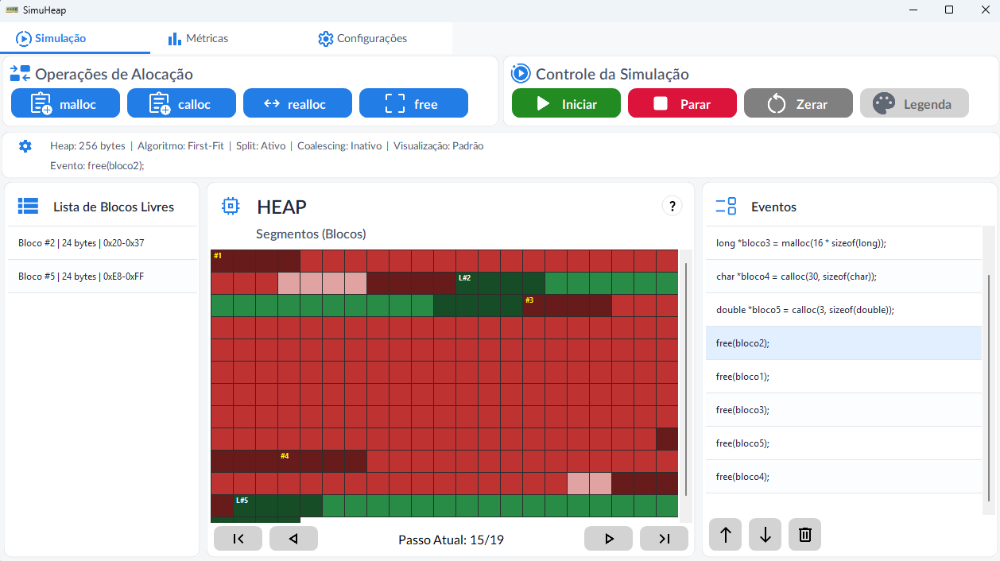
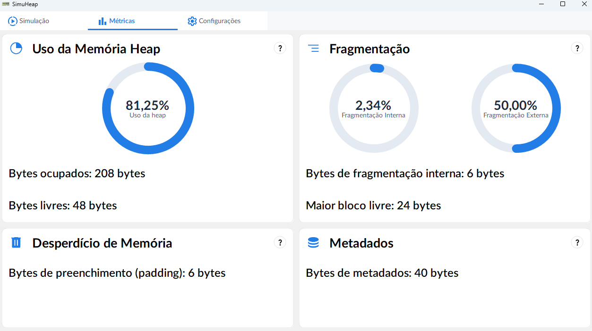
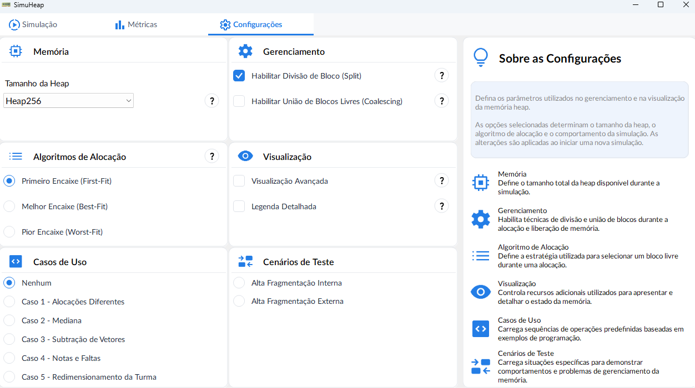

# Simulador Didático de Gerenciamento de Memória Heap

Este projeto consiste em um **simulador didático de gerenciamento de memória heap**, desenvolvido como Trabalho de Conclusão de Curso (TCC) do curso de **Engenharia de Computação da Universidade de Caxias do Sul (UCS)**, sob orientação do professor Samuel Francisco Ferrigo.

O simulador tem como objetivo auxiliar no ensino e na compreensão dos conceitos relacionados à alocação dinâmica de memória, permitindo visualizar o funcionamento de operações como `malloc()`, `calloc()`, `realloc()` e `free()`, utilizadas na linguagem C. A ferramenta busca apresentar de maneira visual e interativa os processos de alocação, realocação e liberação de memória, facilitando a compreensão de conceitos que normalmente são abordados de forma teórica.

Desenvolvido em **C# com Windows Forms e .NET 9**, o software permite executar simulações passo a passo, acompanhando as alterações realizadas na memória heap. São representados aspectos como a organização dos blocos, regiões de metadados, alinhamento de memória, estratégias de alocação e técnicas de divisão (*split*) e união de blocos livres (*coalescing*).

## Simulação da memória

A interface principal apresenta uma representação gráfica da memória heap, permitindo acompanhar cada etapa das operações realizadas. Os blocos são diferenciados visualmente conforme seu estado e estrutura, possibilitando identificar regiões livres, ocupadas e informações associadas às alocações.

## Métricas de memória

O simulador também disponibiliza métricas relacionadas à utilização da memória, incluindo a quantidade de bytes ocupados e livres, percentual de utilização e indicadores de fragmentação interna e externa. Essas informações permitem analisar os efeitos das operações e das estratégias de gerenciamento sobre o aproveitamento do espaço disponível.

## Configurações da simulação

A ferramenta permite configurar parâmetros de funcionamento da simulação, como o tamanho da memória heap, a estratégia de alocação e a utilização das técnicas de *split* e *coalescing*. Dessa forma, é possível explorar diferentes cenários e observar como as configurações influenciam a organização e o gerenciamento da memória.

